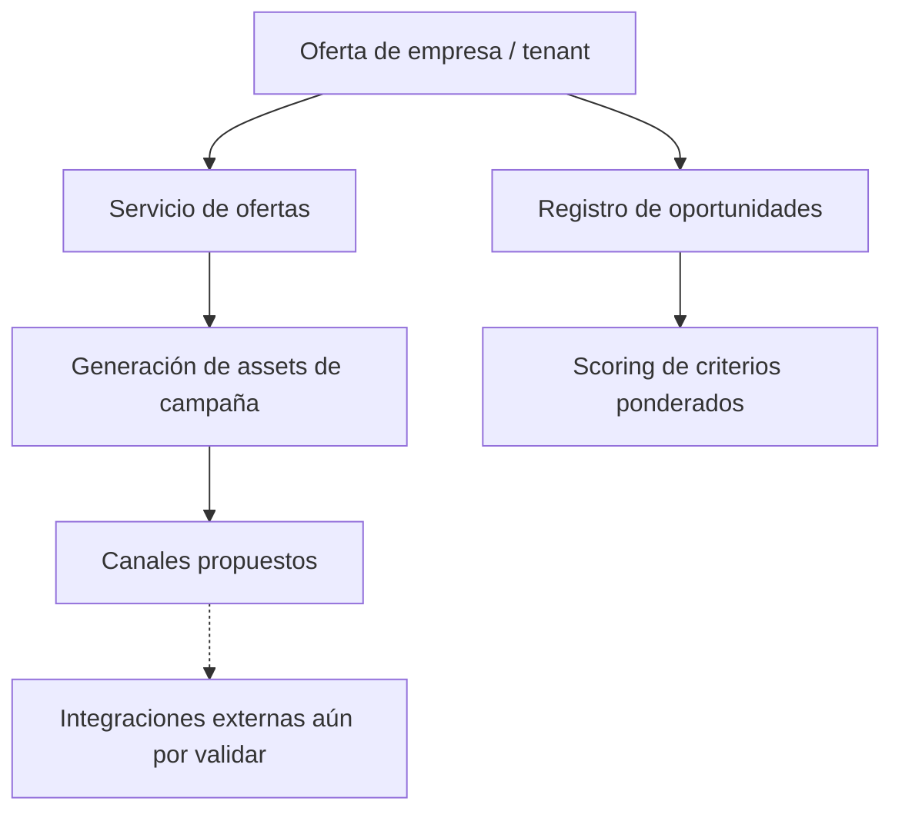

# MasterTech Growth OS — Automatización y análisis comercial

**Prototipo de ingeniería de MasterTech SpA** para gestionar ofertas, construir activos de campañas y clasificar oportunidades mediante un modelo de puntuación determinista. Se organiza como monorepositorio con API TypeScript/Express, Prisma y herramientas de ejecución locales.

> **Estado:** investigación y desarrollo. Aunque el código define entidades como `Tenant`, `Offer`, `Campaign` y `Lead`, no se ha validado aquí el aislamiento multiempresa en todas las rutas, la entrega efectiva en plataformas publicitarias ni la existencia de resultados comerciales. **No utilizar datos reales de prospectos o enviar campañas automáticamente sin permiso.**

## Qué pretende resolver

Las empresas necesitan organizar propuestas, canales y oportunidades comerciales sin mezclar datos de distintos clientes. Growth OS explora un flujo que parte de una oferta y produce representaciones de campañas y puntuaciones de leads, separando la generación interna de activos de los envíos hacia terceros.

## Componentes del repositorio

| Ruta | Función |
|---|---|
| [`apps/`](apps/) | Aplicaciones, incluidos experimentos de API y escritorio |
| [`packages/`](packages/) | Módulos compartidos y configuración de persistencia |
| [`packages/database/prisma/schema.prisma`](packages/database/prisma/schema.prisma) | Modelo de datos de Prisma |
| [`docker-compose.yml`](docker-compose.yml) | Servicios locales de laboratorio |
| [`docs/`](docs/) | Plan de producto, auditoría y evolución |
| [`package.json`](package.json) | Comandos y dependencias Node.js |

## Arquitectura experimental



**Importante:** un asset de campaña generado internamente no es evidencia de anuncio publicado, mensaje enviado o venta realizada.

## Inicio de desarrollo local

**Stack declarado:** Node.js, TypeScript/tsx, Express, Prisma con SQLite en el entorno de laboratorio y componentes de colas Redis/BullMQ. Las instrucciones existentes utilizan Node.js 24; fijar la versión y comprobar compatibilidad antes de integrarlo a CI.

```bash
npm install
npx prisma db push --schema=packages/database/prisma/schema.prisma
npm run dev:api
```

La API se documenta originalmente en `http://localhost:4000`. Ejecutar `prisma db push` **únicamente con una base de pruebas o descartable**, no sobre datos de clientes ni entornos compartidos.

**Estado de calidad actual:** en [`package.json`](package.json), `npm test` es todavía un comando placeholder que devuelve error. **No hay una suite automatizada verificada por ese comando**. Corresponde añadir pruebas antes de aceptar el prototipo como estable.

## Flujos HTTP descritos

| Operación | Ruta propuesta |
|---|---|
| Crear tenant | `POST /api/tenants` |
| Registrar oferta | `POST /api/tenants/:tenantId/offers` |
| Consultar campañas | `GET /api/tenants/:tenantId/campaigns` |
| Registrar oportunidad | `POST /api/tenants/:tenantId/leads` |
| Consultar oportunidades | `GET /api/tenants/:tenantId/leads` |

La documentación de rutas refleja el diseño presente y debe contrastarse con controladores, estado real de los workers y pruebas de extremo a extremo. No garantiza que todas las operaciones funcionen sin configuración adicional.

## Scoring de demostración

La documentación histórica utiliza reglas ponderadas para industria, ubicación, necesidad identificada, presupuesto, interacción previa y temporalidad. Este enfoque es **heurístico**, no un modelo predictivo validado. Las puntuaciones no prueban intención real de compra y no deben justificar decisiones discriminatorias o contactar personas sin autorización.

## Riesgos que bloquean una comercialización

1. **Autorización:** comprobar autenticación e aislamiento de cada tenant y cada recurso en todas las operaciones.
2. **Canales:** consentimiento, opt-out, políticas publicitarias, presupuestos y aprobaciones antes de cualquier envío.
3. **Persistencia:** migraciones versionadas, secretos y recuperaciones probadas; no usar `db push` como proceso de producción.
4. **Resiliencia:** trabajos asíncronos idempotentes, reintentos acotados, control de cola y observabilidad.
5. **Evidencia de producto:** pruebas automatizadas, entrevistas y mediciones reales de adopción/costos; evitar tasas de conversión inventadas.
6. **Licencias:** el manifiesto declara MIT, pero conviene verificar la existencia de un archivo LICENSE y los derechos de dependencias o material de terceros antes de redistribuir.

## Roadmap y fuentes

[Revisión de ingeniería](docs/ENGINEERING_ROADMAP_2026-11-04.md) · [Arquitectura y escalabilidad](docs/ARCHITECTURE_SCALABILITY_2026-11-04.md).

**Estado corporativo:** iniciativa técnica de MasterTech SpA sin ingresos, clientes o efectividad de campañas confirmados por este repositorio.
